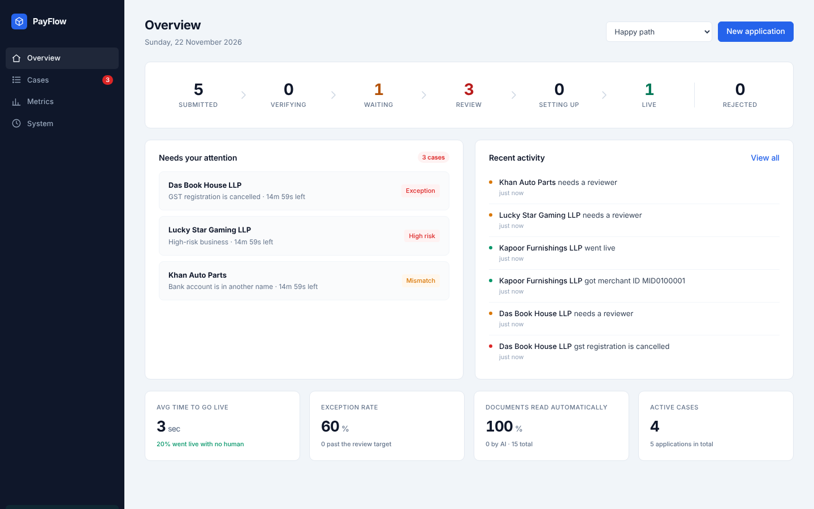
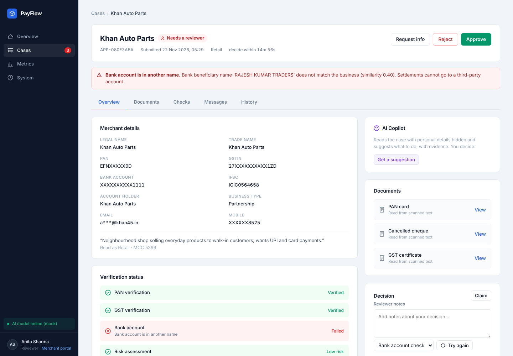
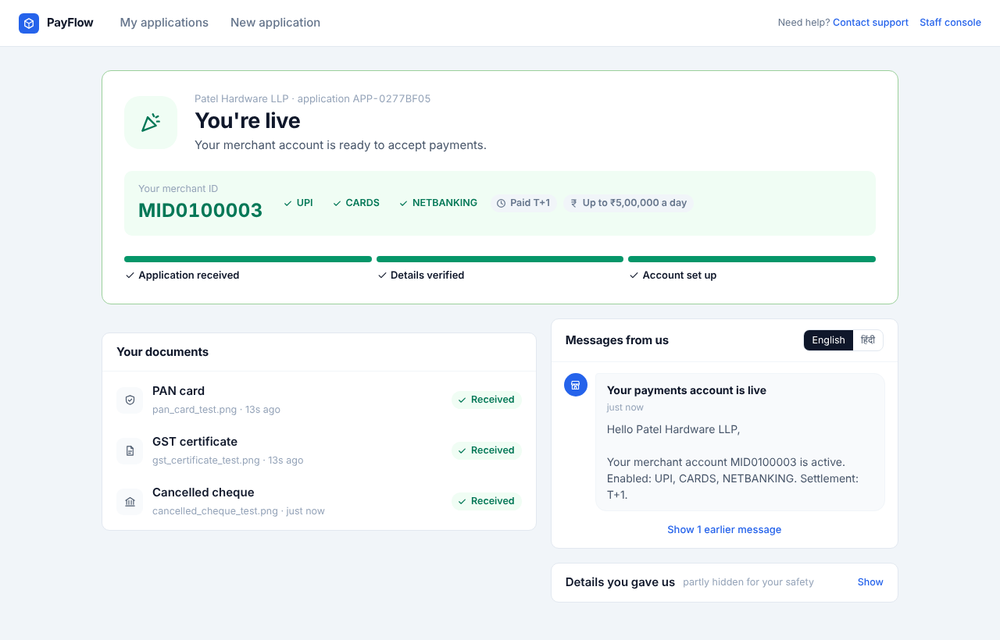

# PayFlow: Autonomous Merchant Onboarding

A working prototype of merchant onboarding for a payments company. A merchant applies online and uploads their PAN card, GST certificate and cancelled cheque. The platform reads the documents with AI, verifies them against simulated PAN, GST, bank and risk providers, and either activates the merchant or routes the case to a human reviewer with the reason and evidence.



## Features

- **Document AI.** Claude reads photos and PDFs, returns each field with a confidence score, and flags blurred, mismatched or tampered documents, including prompt-injection attempts.
- **Event-driven workflow.** An explicit state machine with one decision rule. Asynchronous, signed provider callbacks, with duplicate, late and stale answers handled.
- **Resilience.** Timeouts, retries with backoff, a dead-letter queue with replay, idempotent merchant-ID creation and a transactional outbox. Restarts are safe.
- **Human in the loop.** A review queue with an SLA, claim and release, an AI copilot that suggests but never decides, and a second reviewer for serious waivers. PAN and bank checks can never be waived.
- **Merchant portal.** A guided application, drag-and-drop uploads, a live status page, and messages in English and Hindi.
- **Privacy.** Identifiers masked everywhere, an audited "reveal", masked audit history and keyed fingerprints for duplicate detection.
- **Metrics.** Funnel, time in each stage, exception rate, how documents were read, provider latency and AI cost.

| Case review | Merchant portal |
|---|---|
|  |  |

## Quick start

Requires Python 3.10+. There are no packages to install.

```bash
python run.py --reset --demo
```

- Operations console: http://localhost:8000
- Merchant portal: http://localhost:8000/apply

`--demo` pre-loads two applications: one that goes live and one escalated because its GST registration is cancelled. On Windows, double-click `start.bat`.

### Connecting Claude (optional)

Without a key, the app runs on an offline mock model and rule-based fallbacks. To use Claude, copy `.env.example` to `.env`:

```
ANTHROPIC_API_KEY=...
```

For Claude through Microsoft Foundry (Azure), also set:

```
ANTHROPIC_BASE_URL=https://<resource>.services.ai.azure.com/anthropic
LLM_MODEL_VISION=<deployment name>
LLM_MODEL_REASONING=<deployment name>
LLM_MODEL_FAST=<deployment name>
```

`python tools/check_key.py` verifies the key, address and model names without printing the key. OpenAI and Gemini keys are also supported.

## How it works

```
Merchant portal ─┐                                ┌─▶ PAN / GST / Bank / Risk providers (simulated, async webhooks)
                 ├─▶ HTTP API ─▶ Workflow engine ─┼─▶ AI gateway (Claude, with schema checks and fallbacks)
Ops console ─────┘              (SQLite)          └─▶ Merchant ID service (simulated, idempotent)
```

```
SUBMITTED → VERIFYING ⇄ NEEDS_INFO
               ↓
         MANUAL_REVIEW → REJECTED
               ↓
           APPROVED → PROVISIONING → ACTIVE
                           ⇅
                  PROVISIONING_FAILED
```

After every event, a single rule decides the next state:
1. If the merchant owes something, the application moves to `NEEDS_INFO`.
2. If checks are still running, it stays in `VERIFYING`.
3. If any exception is open, it goes to `MANUAL_REVIEW`.
4. If every required check has passed, it moves to `APPROVED` and the merchant ID is created.

AI helps with reading documents, categorising the business, matching bank names, writing merchant messages and the reviewer copilot. Every AI output is schema-checked and has a non-AI fallback. Final decisions are never made by AI.

| Path | Purpose |
|---|---|
| `app/workflow/` | State machine, checks, callbacks, retries, review actions, metrics |
| `app/llm/`, `app/ai.py` | AI gateway, provider adapters, prompts and fallbacks |
| `app/providers.py` | Simulated verification providers and merchant-ID service, with fault injection |
| `app/static/` | Operations console and merchant portal (HTML, CSS and JavaScript, no build step) |
| `tests/` | Workflow, API, AI, adapter and resilience tests |

## Failure scenarios

| Scenario | Behaviour |
|---|---|
| PAN passes, GST cancelled | Escalated to a reviewer. Approving needs two reviewers. |
| Same callback delivered several times | Processed once and the duplicates are counted. |
| Callback after timeout | Retried. A late answer for the same inputs is still accepted. |
| Bank details changed after verification | The bank check re-runs, and answers for the old account are discarded. |
| Merchant ID creation fails | Retried with the same idempotency key, then the dead-letter queue and a manual retry. |
| Blurred or conflicting document | The merchant is asked to re-upload, or the case goes to review. |

You can trigger any of these from the console: use **System** to simulate provider faults, or the sample dropdown next to **New application**.

## Testing

```bash
python -m pytest -q          # 98 tests
python tools/live_e2e.py     # 6 end-to-end cases on a real model
python demo.py               # scripted journeys in the terminal
```

The live suite passes 6/6 on Claude Opus 5 through Microsoft Foundry.

## Assumptions and limitations

- PAN, GST, bank and risk providers, the merchant-ID service and staff login are simulated.
- The sample documents are synthetic. Document images are sent to the AI provider for extraction; everything else it sees is masked or non-personal. Production use would need merchant consent, a data-processing agreement and encryption at rest.
- Single process with SQLite. Production would use Postgres, a job queue and real authentication.
